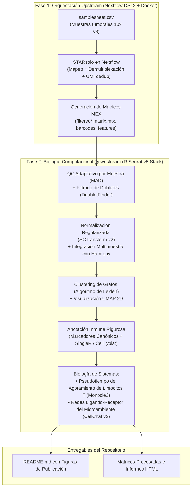

[⬅️ Anterior: Test Autoevaluación M5](../Modulo_5_Biologia_de_Sistemas_Pseudotiempo_y_Comunicacion/Test_Autoevaluacion_M5.md) | [🏠 Temario Principal](../README.md)

---

# Módulo 06: Guía Maestra del Proyecto Final de Graduación

---

## 🎯 Visión y Alcance del Proyecto

El objetivo del Proyecto Final es construir un **Atlas Completo del Microambiente Tumoral Humano a Resolución de Célula Única**, combinando la orquestación masiva y contenerizada de **Nextflow DSL2** para el procesamiento upstream de datos crudos con el modelado biológico downstream en **R (Seurat v5)** y **CellChat v2**.

Este proyecto se desarrolla en su propio repositorio desacoplado para constituir un **proyecto insignia de portafolio independiente en GitHub**, diseñado con rigor para ser evaluado por reclutadores, líderes de bioinformática e investigadores internacionales en inmuno-oncología.

---

## 🧬 Dataset Biológico y Diseño Experimental

* **Enfermedad / Tejido:** Microambiente tumoral en cáncer humano (biopsias tumorales clínicas multirregionales, tecnología 10x Genomics Chromium 3' v3).
* **Muestras:** Cohorte multimuestra de pacientes con diferentes respuestas a inmunoterapia (Respondedores vs. No Respondedores: `patient1_responder`, `patient2_non_responder`, `patient3_non_responder`).
* **Escala del Atlas:** 9.619 células viables post-QC y 33.538 genes analizados.
* **Preguntas Científicas:**
  1. ¿Qué subpoblaciones de linfocitos T infiltrantes de tumor (TILs) presentan fenotipos de agotamiento (*exhaustion*) caracterizados por co-expresión de *PDCD1*, *HAVCR2* y *LAG3*?
  2. ¿Cómo varía la polarización de macrófagos asociados a tumor (TAMs proinflamatorios M1 vs. inmunosupresores M2) entre pacientes respondedores y refractarios?
  3. ¿Cuáles son los ejes de comunicación ligando-receptor dominantes entre los fibroblastos asociados a tumor (CAFs), las células endoteliales y las células tumorales epiteliales?

---

## 🏗️ Arquitectura Técnica de Dos Fases

---

## 📋 Fases de Desarrollo Paso a Paso

### Paso 1: Configuración del Workspace y Pipeline Nextflow
* Configuración de `nextflow.config` con perfiles para `local`, `docker` y gestión de recursos (`label 'process_high'`).
* Implementación del módulo `modules/starsolo.nf` parametrizado para la química 10x Chromium v3.
* Orquestación integral desde `main.nf` con soporte para flags `--run_upstream` y `--run_downstream`.

### Paso 2: Control de Calidad y Dobletes (`scripts/01_qc_and_doublets.R`)
* Auditoría de viabilidad celular con umbrales adaptativos ($\pm 3 \times \text{MAD}$) y porcentaje mitocondrial < 15%.
* Detección y remoción de dobletes heterotípicos.
* Generación de `qc_violins.png` y métricas en `qc_summary_metrics.csv`.

### Paso 3: Integración Multimuestra y Reducción Dimensional (`scripts/02_integrate_cluster.R`)
* Modelado de dispersión por muestra desacoplada con `SCTransform v2` (aceleración C++ con `glmGamPoi`).
* Cálculo de 50 PCs y selección de 30 dimensiones biológicas mediante `ElbowPlot()`.
* Integración espacial en PCA con **Harmony** (`IntegrateLayers`).
* Proyección no lineal bidimensional en espacio integrado mediante UMAP 2D.

### Paso 4: Clustering y Anotación Celular Fina (`scripts/03_annotation.R`)
* Construcción de grafo SNN ($k = 20$) y barrido de estabilidad multiresolución con `clustree` ($\gamma = 0.6$, 16 comunidades).
* Descubrimiento de marcadores diferenciales mediante Wilcoxon rank-sum y modelo de obstáculos en dos partes **MAST**.
* Mapeo fenotípico de 16 subpoblaciones del microambiente tumoral y benchmarking cruzado frente a `SingleR` con matriz de confusión.
* Generación del DotPlot diagnóstico de marcadores canónicos (Figura 2).

### Paso 5: Biología de Sistemas: Trayectorias y Comunicación (`scripts/04_systems_biology.R`)
* Aislamiento de 2.511 linfocitos T CD8+ e inferencia de la trayectoria continua de agotamiento con **Monocle3** (pseudotiempo geodésico).
* Modelado cinético no lineal con splines cúbicos (GAM), documentando el declive de moléculas líticas (`GZMB`, `PRF1`) frente a la sobreexpresión de puntos de control inmunitario (`PDCD1`, `HAVCR2`, `LAG3`).
* Modelado del interactoma célula-célula con **CellChat v2** bajo la ley de acción de masas para los ejes `PD-L1/PD-1`, `TGF-β` y `VEGF-A`.
* Cuantificación de centralidad de red 2D clasificando poblaciones en emisores dominantes (*senders*), receptores (*receivers*) y mediadores.

---

## 📊 Figuras de Calidad de Publicación Generadas

| Figura | Nombre | Descripción Científica |
| :---: | :--- | :--- |
| **Figura 1** | `fig1_integrated_umap.png` | UMAP 2D integrado con Harmony (30 dimensiones) coloreado por 16 comunidades celulares y por respuesta clínica (Respondedor vs No Respondedor). |
| **Figura 2** | `fig2_markers_dotplot.png` | DotPlot de marcadores canónicos que validan la identidad de linfocitos T citotóxicos, agotados, Tregs, TAMs M1/M2, CAFs, células endoteliales y epitelio tumoral. |
| **Figura 3** | `fig3_tcell_exhaustion_trajectory.png` | Trayectoria de pseudotiempo de Monocle3 y curvas cinéticas spline GAM demostrando la transición hacia el estado exhausto terminal. |
| **Figura 4** | `fig4_cellchat_signaling_networks.png` | Mapa de comunicación ligando-receptor de CellChat v2 (eje PD-L1/PD-1) y arquitectura de centralidad de red 2D de emisores y receptores. |

---

[⬅️ Anterior: Test Autoevaluación M5](../Modulo_5_Biologia_de_Sistemas_Pseudotiempo_y_Comunicacion/Test_Autoevaluacion_M5.md) | [🏠 Temario Principal](../README.md)
