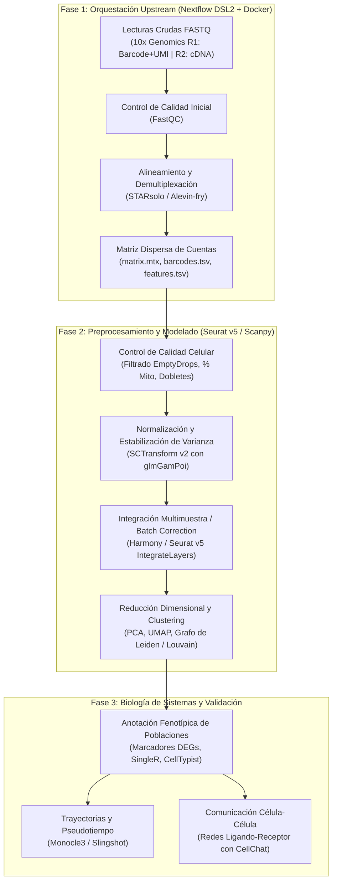

# 🔬 Curso Avanzado: Single-Cell RNA-Seq & Orquestación con Nextflow DSL2
### *De Datos Crudos FASTQ a la Biología de Sistemas Celular*

---

## 📖 Descripción del Curso

La transcriptómica de célula única (**Single-Cell RNA-Seq / scRNA-seq**) ha revolucionado la biomedicina moderna al permitir resolver la heterogeneidad celular, descubrir subpoblaciones raras y mapear trayectorias de diferenciación con resolución individual. 

Sin embargo, el procesamiento de conjuntos de datos de célula única plantea dos grandes desafíos técnicos:
1. **Desafío Computacional Upstream:** Mapear y demultiplexar decenas de millones de lecturas FASTQ (códigos celulares y UMIs de 10x Genomics) exige flujos de trabajo escalables, reproducibles y contenerizados.
2. **Desafío Estadístico Downstream:** La hiperdispersión de ceros técnicos (*dropout*), la variación del tamaño de biblioteca celular y los efectos de lote (*batch effects*) requieren modelado no lineal, reducción de dimensionalidad y algoritmos de integración de última generación.

Este curso proporciona un **itinerario formativo completo y riguroso**, unificando la potencia orquestadora de **Nextflow DSL2** con las librerías líderes de análisis downstream (**Seurat v5** en R y **Scanpy** en Python).

---

## 🗺️ Arquitectura Integral del Pipeline (DAG)

---

## 📚 Estructura y Temario del Curso

| Módulo | Título | Lecciones y Contenidos Clave | Estado | Entregables y Prácticas |
| :---: | :--- | :--- | :---: | :---: |
| **00** | **Entorno e Instalación** | Entornos reproducibles ([`environment_r.yml`](00_Entorno_e_Instalacion/environment_r.yml), [`environment_python.yml`](00_Entorno_e_Instalacion/environment_python.yml)) y recetas Docker. | ✅ Disponible | Verificación de instalación. |
| **01** | [**Upstream Nextflow DSL2**](Modulo_1_Fundamentos_y_Preprocesamiento_Nextflow/Leccion_01_Tecnologia_10x_Genomics_y_Estructura_FASTQ.md) | • [Lección 01: Tecnología 10x y FASTQ](Modulo_1_Fundamentos_y_Preprocesamiento_Nextflow/Leccion_01_Tecnologia_10x_Genomics_y_Estructura_FASTQ.md) • [Lección 02: STARsolo y Cuantificación](Modulo_1_Fundamentos_y_Preprocesamiento_Nextflow/Leccion_02_STARsolo_y_Cuantificacion_Alineamiento.md) • [Lección 03: Pipeline Nextflow DSL2](Modulo_1_Fundamentos_y_Preprocesamiento_Nextflow/Leccion_03_Pipeline_Nextflow_DSL2_para_scRNAseq.md) | ✅ Disponible | • [Ejercicios M1](Modulo_1_Fundamentos_y_Preprocesamiento_Nextflow/Ejercicios_M1.md) • [Test M1](Modulo_1_Fundamentos_y_Preprocesamiento_Nextflow/Test_Autoevaluacion_M1.md) |
| **02** | **Control de Calidad y Dobletes** | • Métricas QC y umbrales adaptativos (MAD) • Gotas Vacías con EmptyDrops • Purga de Dobletes con DoubletFinder | 🚧 *En desarrollo* | Próximamente (Hito 1 + Test M2) |
| **03** | **Normalización e Integración** | • Modelado GLM-NB con SCTransform v2 • Reducción PCA y selección de PCs • Corrección de batch effects con Harmony | 🚧 *En desarrollo* | Próximamente (Ejercicios M3 + Test M3) |
| **04** | **Clustering y Anotación Celular** | • Algoritmo de Leiden y análisis con clustree • Marcadores con modelo bi-fásico MAST • Anotación manual vs SingleR / CellTypist | 🚧 *En desarrollo* | Próximamente (Hito 2 + Test M4) |
| **05** | **Biología de Sistemas** | • Trayectorias y pseudotiempo con Monocle3 • Autocorrelación espacial de Moran y splines • Redes ligando-receptor con CellChat v2 | 🚧 *En desarrollo* | Próximamente (Ejercicios M5 + Test M5) |
| **06** | **Proyecto Final de Graduación** | • Atlas del Microambiente Tumoral Humano • Análisis completo end-to-end de cohorte oncológica | 🚧 *En desarrollo* | Próximamente |

---

## ⚙️ Requisitos del Sistema

* **Sistema Operativo:** Linux (Ubuntu $\ge 22.04$) o Windows 10/11 con **WSL2** activado.
* **Procesador:** $\ge 4$ núcleos de CPU (recomendado $\ge 8$ para alineamiento con STARsolo).
* **Memoria RAM:** Mínimo 16 GB (recomendado 32 GB para indexación y matrices multicelulares).
* **Software:** Docker Engine $\ge 24.0$, Conda / Mamba, Nextflow $\ge 24.04$, R $\ge 4.4$.
