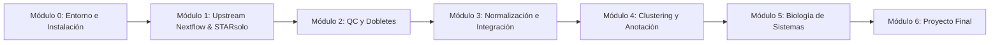

# 🔬 Curso Completo de Single-Cell RNA-Seq & Nextflow DSL2
### *De Datos Crudos FASTQ a la Biología de Sistemas Celular*

[](https://www.nextflow.io/)
[](https://satijalab.org/seurat/)
[](https://scanpy.readthedocs.io/)
[](https://www.docker.com/)
[](LICENSE)

Bienvenido/a a este curso abierto, intensivo y estructurado sobre **transcriptómica de célula única (scRNA-seq)** y orquestación reproducible con **Nextflow DSL2**.

Este repositorio está organizado como un curso interactivo de **múltiples páginas**, guiándote paso a paso desde el procesamiento masivo upstream de lecturas FASTQ de 10x Genomics con **STARsolo**, hasta el modelado bioestadístico downstream, integración multimuestra y análisis de biología de sistemas celulares con **Seurat v5**, **Harmony**, **Monocle3** y **CellChat v2**.

---

## 🗺️ Mapa de Ruta del Curso



---

## 📚 Índice de Contenidos

### 🔹 Módulo 0: Entorno e Instalación
Configura un entorno computacional bioinformático reproducible y aislado para R (Seurat v5) y Python (Scanpy).

| # | Documento / Receta | Temas Principales |
| :-: | :--- | :--- |
| **00** | [⚙️ Receta Conda R (Seurat v5)](00_Entorno_e_Instalacion/environment_r.yml) | R 4.4, Seurat v5.1, glmGamPoi, SingleR, celldex, DropletUtils, Harmony. |
| **00** | [⚙️ Receta Conda Python (Scanpy)](00_Entorno_e_Instalacion/environment_python.yml) | Python 3.11, Scanpy 1.10, anndata, leidenalg, scrublet, celltypist. |

---

### 🔹 Módulo 1: Upstream Nextflow DSL2 — Del FASTQ a la Matriz de Conteo
Domina la arquitectura física de microgotas de 10x Genomics, la anatomía de lecturas asimétricas y la cuantificación a nivel de gen con STARsolo en Nextflow DSL2.

| # | Documento / Lección | Temas Principales |
| :-: | :--- | :--- |
| **01** | [📖 Lección 1: Tecnología 10x y Estructura FASTQ](Modulo_1_Fundamentos_y_Preprocesamiento_Nextflow/Leccion_01_Tecnologia_10x_Genomics_y_Estructura_FASTQ.md) | Gotas GEM, Cell Barcodes (CB), Unique Molecular Identifiers (UMI), corrección con Whitelist y eliminación del sesgo de PCR. |
| **02** | [📖 Lección 2: STARsolo y Algoritmos de Cuantificación](Modulo_1_Fundamentos_y_Preprocesamiento_Nextflow/Leccion_02_STARsolo_y_Cuantificacion_Alineamiento.md) | Velocidad frente a Cell Ranger, paridad algorítmica (`EmptyDrops_CR`, `1MM_CR`) y matrices dispersas MEX (`matrix.mtx`). |
| **03** | [📖 Lección 3: Pipeline Nextflow DSL2 para scRNA-seq](Modulo_1_Fundamentos_y_Preprocesamiento_Nextflow/Leccion_03_Pipeline_Nextflow_DSL2_para_scRNAseq.md) | Manifiesto `samplesheet.csv`, módulo modular `STARSOLO`, contenedores Docker de Quay.io y canales reactivos downstream. |
| **🏋️** | [🏋️ Ejercicios Prácticos del Módulo 1](Modulo_1_Fundamentos_y_Preprocesamiento_Nextflow/Ejercicios_M1.md) | Asignación dinámica de químicas v2/v3, optimización de almacenamiento en disco (`--outSAMtype None`) y operador `.collectFile`. |
| **📝** | [📝 Test de Autoevaluación del Módulo 1](Modulo_1_Fundamentos_y_Preprocesamiento_Nextflow/Test_Autoevaluacion_M1.md) | 5 preguntas conceptuales y de arquitectura sobre cuantificación de célula única. |

---

### 🔹 Módulo 2: Control de Calidad Celular y Detección de Dobletes
Audita la viabilidad celular con rigor estadístico: filtrado adaptativo con MAD, modelado de ARN ambiental libre con EmptyDrops y purga de dobletes heterotípicos.

| # | Documento / Lección | Temas Principales |
| :-: | :--- | :--- |
| **04** | [📖 Lección 4: Métricas QC y Umbrales Adaptativos](Modulo_2_Control_de_Calidad_y_Dobletes/Leccion_01_Metricas_QC_y_Filtrado_Adaptativo.md) | Métricas `nFeature`, `nCount`, `percent.mt` y por qué los umbrales fijos son un error. Desviación Absoluta de la Mediana (MAD). |
| **05** | [📖 Lección 5: Detección de Gotas Vacías con EmptyDrops](Modulo_2_Control_de_Calidad_y_Dobletes/Leccion_02_Deteccion_de_Gotas_Vacias_con_EmptyDrops.md) | El fenómeno del ARN ambiental (*soup*), modelo Dirichlet-multinomial y valor de significancia FDR. |
| **06** | [📖 Lección 6: Identificación y Purga de Dobletes](Modulo_2_Control_de_Calidad_y_Dobletes/Leccion_03_Identificacion_y_Purga_de_Dobletes_Heterotipicos.md) | Dobletes homotípicos vs heterotípicos, vecinos artificiales en PCA y optimización de $pK$ con `DoubletFinder`. |
| **🎯** | [🎯 HITO 1: Pipeline QC Multivariante Adaptativo](Modulo_2_Control_de_Calidad_y_Dobletes/Hito_01_Pipeline_QC_Multivariante_Adaptativo.md) | Reto integrador: script automatizado de filtrado multivariante por muestra con generación de figuras diagnósticas. |
| **📝** | [📝 Test de Autoevaluación del Módulo 2](Modulo_2_Control_de_Calidad_y_Dobletes/Test_Autoevaluacion_M2.md) | 5 preguntas sobre modelado de viabilidad celular y sesgos técnicos. |

---

### 🔹 Módulo 3: Normalización, Integración Multimuestra y Reducción
Supera la hiperdispersión y ceros técnicos: modelado de varianza con SCTransform v2, reducción lineal en PCA y corrección de efectos de lote con Harmony.

| # | Documento / Lección | Temas Principales |
| :-: | :--- | :--- |
| **07** | [📖 Lección 7: Normalización Regularizada con SCTransform v2](Modulo_3_Normalizacion_Integracion_y_Reduccion/Leccion_01_Normalizacion_SCTransform_v2.md) | Fallos de `LogNormalize`, modelos lineales generalizados binomiales negativos (GLM-NB), residuos de Pearson y aceleración con `glmGamPoi`. |
| **08** | [📖 Lección 8: Reducción Dimensional y Selección de PCs](Modulo_3_Normalizacion_Integracion_y_Reduccion/Leccion_02_Reduccion_de_Dimensionalidad_PCA_y_Seleccion_de_PCs.md) | Espacio de genes altamente variables (HVGs), PCA ortogonal y selección de dimensiones informativas con `ElbowPlot` y `JackStraw`. |
| **09** | [📖 Lección 9: Corrección de Efectos de Lote con Harmony](Modulo_3_Normalizacion_Integracion_y_Reduccion/Leccion_03_Integracion_Multimuestra_con_Harmony_en_Seurat_v5.md) | Efectos de lote entre pacientes, arquitectura de capas (`layers`) en Seurat v5, clustering difuso en Harmony y proyección UMAP 2D. |
| **🏋️** | [🏋️ Ejercicios Prácticos del Módulo 3](Modulo_3_Normalizacion_Integracion_y_Reduccion/Ejercicios_M3.md) | Pruebas empíricas de residuos de Pearson, métricas de mezcla (LISI/kBET) y preparación de capas con `PrepSCTFindMarkers`. |
| **📝** | [📝 Test de Autoevaluación del Módulo 3](Modulo_3_Normalizacion_Integracion_y_Reduccion/Test_Autoevaluacion_M3.md) | 5 preguntas sobre estabilización de varianza e integración de cohortes. |

---

### 🔹 Módulo 4: Clustering, Marcadores Génicos y Anotación Celular
Agrupa células por identidad biológica: particiones conexas con Leiden, contrastes diferenciales con modelos Hurdle (MAST) y anotación híbrida con SingleR y CellTypist.

| # | Documento / Lección | Temas Principales |
| :-: | :--- | :--- |
| **10** | [📖 Lección 10: Grafos SNN, Louvain y Algoritmo de Leiden](Modulo_4_Clustering_Marcadores_y_Anotacion/Leccion_01_Algoritmos_de_Clustering_de_Grafos_Louvain_y_Leiden.md) | Grafos de vecindad compartida (SNN), modularidad, conectividad garantizada en Leiden y exploración de resolución con `clustree`. |
| **11** | [📖 Lección 11: Detección de Marcadores y Modelo MAST](Modulo_4_Clustering_Marcadores_y_Anotacion/Leccion_02_Identificacion_de_Marcadores_y_Expresion_Diferencial.md) | Manejo del dropout técnico, contrastes Wilcoxon rank-sum y modelo Hurdle de dos partes con MAST. DotPlots y Heatmaps. |
| **12** | [📖 Lección 12: Anotación Manual vs. Automatizada con IA](Modulo_4_Clustering_Marcadores_y_Anotacion/Leccion_03_Estrategias_de_Anotacion_Manual_vs_Automatizada.md) | Paneles canónicos de linaje inmune y estromal, correlación con atlas curados en `SingleR` y modelos predictivos con `CellTypist`. |
| **🎯** | [🎯 HITO 2: Benchmarking de Anotación en Subpoblaciones Raras](Modulo_4_Clustering_Marcadores_y_Anotacion/Hito_02_Benchmarking_Anotacion_Fenotipica_Subpoblaciones.md) | Práctica integradora: resolución de Tregs, células T exhaustas y macrófagos TAM con matriz de confusión y cálculo de ARI. |
| **📝** | [📝 Test de Autoevaluación del Módulo 4](Modulo_4_Clustering_Marcadores_y_Anotacion/Test_Autoevaluacion_M4.md) | 5 preguntas sobre clustering de grafos y asignación fenotípica. |

---

### 🔹 Módulo 5: Biología de Sistemas — Pseudotiempo y Comunicación Intercelular *(🚧 En desarrollo)*
Explora las dinámicas temporales y el diálogo celular en el tejido: trayectorias con Monocle3 y redes ligando-receptor con CellChat v2.

| # | Documento / Lección | Temas Principales |
| :-: | :--- | :--- |
| **13** | 📖 Lección 13: Inferencia de Trayectorias con Monocle3 | Paisaje de Waddington, aprendizaje de grafos principales con `SimplePPT`, ramificaciones y escala continua de pseudotiempo. |
| **14** | 📖 Lección 14: Dinámicas Temporales y Autocorrelación Espacial | Test espacial de Moran ($I$) con `graph_test()`, módulos génicos co-regulados y curvas cinéticas spline. |
| **15** | 📖 Lección 15: Comunicación Célula-Célula con CellChat v2 | Base de datos `CellChatDB`, complejos multiméricos, ley de acción de masas, roles de red (*senders/receivers*) y diagramas de cuerdas. |
| **🏋️** | 🏋️ Ejercicios Prácticos del Módulo 5 | Inferencia de diferenciación celular, factores de transcripción dinámicos y cuantificación del eje PD-L1/PD-1. |
| **📝** | 📝 Test de Autoevaluación del Módulo 5 | 5 preguntas sobre biología de sistemas a resolución de célula única. |

---

### 🎓 Módulo 6: Proyecto Final de Graduación *(🚧 En desarrollo)*
Construcción de un atlas completo del microambiente tumoral humano (`tumor-microenvironment-scrna-atlas`) a partir de datos reales de 10x Genomics, integrando Nextflow DSL2 upstream y el stack completo de Seurat v5 y CellChat downstream.

| # | Documento / Guía | Temas Principales |
| :-: | :--- | :--- |
| **🎓** | 🎓 Guía Maestra del Proyecto Final | Especificaciones de cohorte tumoral, arquitectura contenerizada, caracterización de infiltrados inmunes y rúbrica de evaluación. |

---

## 🚀 Requisitos Previos e Instalación

Para poner en práctica los pipelines, ejemplos y ejercicios de este curso, se recomienda disponer de:

1. **Linux o Windows con WSL2 (Ubuntu 22.04 LTS o superior).**
2. **Nextflow (versión 24.04 o superior):**
   ```bash
   curl -s https://get.nextflow.io | bash
   sudo mv nextflow /usr/local/bin/
   nextflow info
   ```
3. **Motor de contenedores:** Docker Engine instalado y en ejecución para soportar los contenedores BioContainers de STARsolo y Seurat v5.
4. **Entornos de R (Seurat v5) y Python (Scanpy):** Instalables mediante las recetas conda del Módulo 00:
   ```bash
   # Entorno R 4.4 con Seurat v5 y Bioconductor
   conda env create -f 00_Entorno_e_Instalacion/environment_r.yml

   # Entorno Python 3.11 con Scanpy
   conda env create -f 00_Entorno_e_Instalacion/environment_python.yml
   ```

---

## 🎯 Metodología de Aprendizaje Recomendada

1. **Lectura activa e interactiva:** Sigue el orden secuencial de las lecciones utilizando la barra de navegación situada al principio y al final de cada página (`[⬅️ Anterior] | [🏠 Temario Principal] | [Siguiente ➡️]`).
2. **Experimentación práctica:** Copia y ejecuta los scripts en tu terminal y consola de R para inspeccionar las matrices MEX intermedias, los objetos Seurat y las reducciones dimensionales.
3. **Resolución de problemas y retos:** Desarrolla los ejercicios y los hitos prácticos propuestos en cada módulo para consolidar la toma de decisiones bioinformáticas.
4. **Autoevaluación rigurosa:** Responde a los tests conceptuales para afianzar los fundamentos matemáticos, estadísticos y biológicos de cada técnica.

---

## 📖 Recursos y Documentación Oficial

- [Documentación Oficial de 10x Genomics](https://www.10xgenomics.com/support)
- [STARsolo Documentation](https://github.com/alexdobin/STAR/blob/master/docs/STARsolo.md)
- [Seurat v5 Documentation & Vignettes](https://satijalab.org/seurat/)
- [Orchestrating Single-Cell Analysis with Bioconductor (OSCA)](https://bioconductor.org/books/release/OSCA/)
- [Harmony (Fast, sensitive and flexible integration)](https://github.com/immunogenomics/harmony)
- [CellChat v2 Vignettes](https://github.com/jinworks/CellChat)
- [Monocle3 Documentation](https://cole-trapnell-lab.github.io/monocle3/)
- [Nextflow DSL2 Documentation](https://www.nextflow.io/docs/latest/)

---

## 👤 Autora / Mantenimiento

Repositorio creado y mantenido por [@menmati](https://github.com/menmati).  
Contribuciones, mejoras y sugerencias son bienvenidas a través de Pull Requests e Issues.
